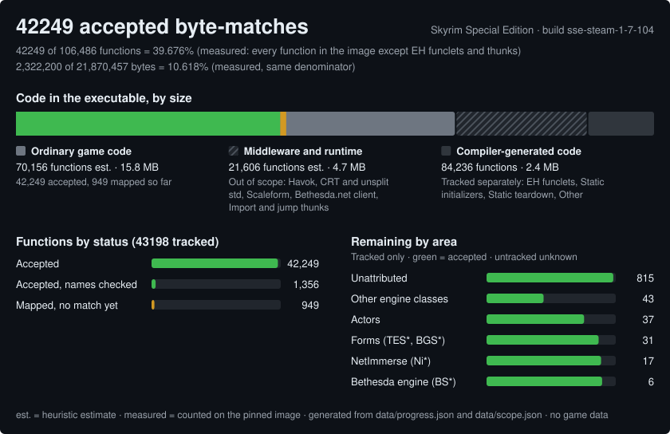
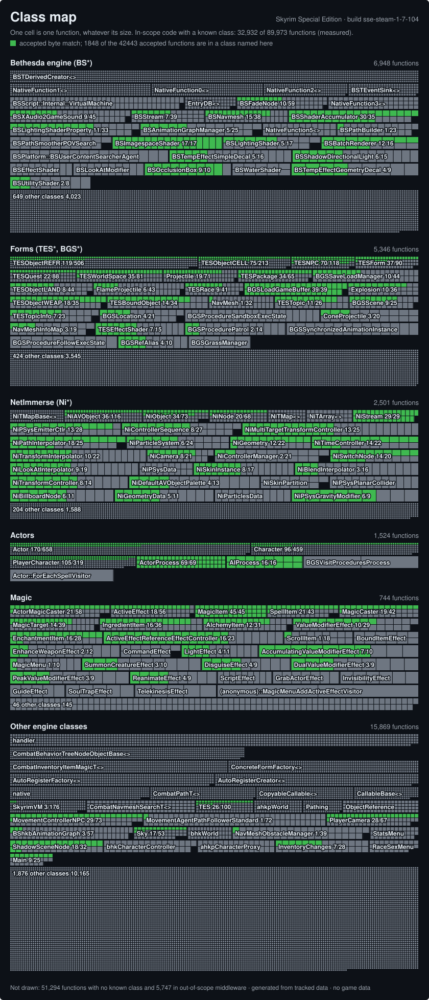
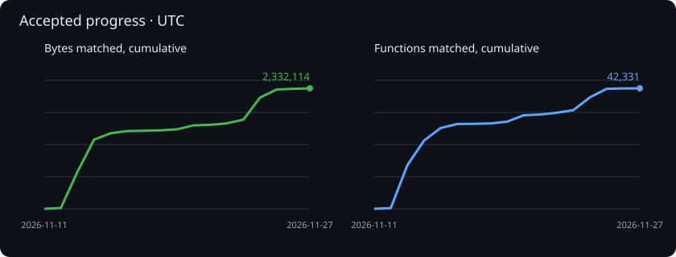
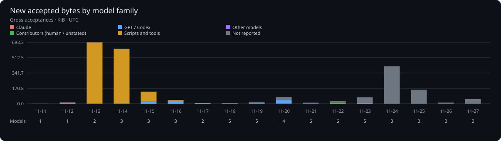

# Skyrim SE Decompilation

A matching decompilation of Skyrim Special Edition (Steam 1.7.104). The goal is to reconstruct every function in C++ that compiles to the exact original bytes.

**No humans in the loop.** Contributions are reviewed and merged automatically by AI agents, with credit to you. Matches are re-verified on two independent machines: our build host compares against the project’s game copy, and a GitHub Windows CI runner checks the compiled bytes against published target hashes.

<a href="https://discord.gg/tbXD8gwgjJ"></a>

## Progress



The top bar is all code in the executable by size: green is accepted byte matches, amber is mapped
functions not yet matched, grey is game code not started; the hatched segment is out of scope
(middleware, CRT) and the dark one is tracked separately (generated initializers, exception-handling
funclets). Counts marked "est." are estimates; a percentage is given only against the measured
denominator named beside it.



In the class map every cell is one function and every tile is one class, for the in-scope code whose
class is known; green cells are accepted. Only the largest classes of each area are named, so most
accepted functions sit in classes it does not draw. Both pictures are generated by
`tools/build_progress_svg.py` from tracked data; see the [report site](https://mudcrab-team.github.io/skyrim_decomp/).

### Daily accepted code





Bars show gross acceptances on the accepting commit's UTC date; reacceptances count again.
The cumulative charts reflect revocations and size corrections. Attribution is a recorded
claim about the Drafter model or generating tool, not proof of authorship; review and acceptance
models are not counted. The model comes from the contributor's PR summary (kept in each record), the
unit header or the generating tool; a contributor who states no model or no AI is charted as
"Contributors (human / unstated)", and tool-stamped units as scripts and tools. Distinct model
counts exclude those and unreported claims. One KiB is
1,024 bytes. The [report site](https://mudcrab-team.github.io/skyrim_decomp/) has daily details.

<!-- model-trend-totals -->
| Model family | Gross accepted bytes |
| --- | ---: |
| Claude | 39,731 |
| GPT / Codex | 130,742 |
| Other models | 8,762 |
| Contributors (human / unstated) | 4,289 |
| Scripts and tools | 1,440,901 |
| Not reported | 515,110 |
<!-- /model-trend-totals -->

Regenerate from tracked first-parent history in a full checkout with
`python3 tools/build_model_trend.py`. Attribution does not affect the acceptance rule.

## Contribute in 3 commands

```sh
./sr go         # set up, pick a small function, claim it, create its source file
./sr compare    # compile and compare locally; repeat until PASS
./sr submit     # open the pull request (source and a sanitized summary only)
```

On Windows, use `.\sr.cmd` in place of `./sr`.
You need git, Python 3.11+, a GitHub account and your own Steam copy.
`./sr next` suggests a function; claims appear as issues. Bigger PRs are welcome: 50 to 200 functions, one PR per family, and subagents for the drafting ([how](docs/contributor-card.md)).
See the [agent guide](docs/contributing-agent.md) and [contribution guide](CONTRIBUTING.md).
Questions or tooling trouble: ask in [Discussions (Q&A)](https://github.com/Mudcrab-Team/skyrim_decomp/discussions/categories/q-a); bugs go in issues.
Tip: if cloning stalls, run `git -c http.version=HTTP/1.1 clone https://github.com/Mudcrab-Team/skyrim_decomp.git`.

## What happens after you submit

- Agents review the source and provenance.
- The match is re-run on two independent machines.
- It merges automatically after acceptance and you appear on the [Leaderboard](LEADERBOARD.md).

Examples of merged outside contributions: [#56](https://github.com/Mudcrab-Team/skyrim_decomp/pull/56) and [#59](https://github.com/Mudcrab-Team/skyrim_decomp/pull/59).
Intake runs automatically; follow your PR's labels and comments for status.

## FAQ

**Q: Isn't this AI slop? Why should I bother?**

A: Right now it is 100% AI slop, and that's intended. The project comes in two stages. Stage 1 is the AI slop decomp; Stage 2 is a C++ refactor that makes the code readable and maintainable. We would love to output readable, maintainable C++ from day one, but AI isn't there yet. So the plan goes in steps: first decompile with AI, then write unit tests, then refactor with a knowledgeable human in the loop, making sure the unit tests still pass.

**Q: How is this going to be helpful at all? Even at Stage 2, with less AI slop?**

A: Imagine Skyrim with a Vulkan renderer running at 500+ fps on a potato PC. Open cities and homes with no loading screens. No need for DynDOLOD to get pretty LODs, even with mods. Projects like [NV-Forever](https://nv-forever.com/) move so fast precisely because a decomp exists.

Then there are individual modders. Libraries like [CommonLibSSE-NG](https://ng.commonlib.dev/) give you reverse-engineered headers (class layouts, function signatures) and the addresses to call into the game, but not the game's actual code. Imagine what modders could do with real source they can read, modify and patch. Here is a video showing how to add power armor to New Vegas: https://www.youtube.com/watch?v=4UsAkrIUixg

**Q: Are you really letting randos on the internet contribute to your project without any human review? Isn't that stupid?**

A: The answer is [byte-exact verification](https://www.fnvdecomp.com/how). The code you push has to compile to exactly the same bytes as the original, and automated CI confirms it by compiling it on two machines, one of them a Windows CI runner. Then an AI agent reviews the PR for plausibility, and it has to pass before the bot merges it. There is no human in the loop. That's what AI in 2026 should be used for: boring, monotonous tasks that are easy to verify, and decompiling functions is exactly that kind of task. You can [learn more about byte-exact verification here](https://www.fnvdecomp.com/how).

**Q: That will never work!**

A: The [FNV](https://www.fnvdecomp.com) and [FO3](https://f3decomp.com/) decomps proved it's possible. It won't be fast, but it's possible. Hence the call for contributors: the more people we have, the faster it happens.

## Links

[Progress site](https://mudcrab-team.github.io/skyrim_decomp/) · [Reconstruction index](reconstruction/INDEX.md) · [Issues](https://github.com/Mudcrab-Team/skyrim_decomp/issues) · [Leaderboard](LEADERBOARD.md)

## More

[How matching is verified](docs/verification.md)
[Internal agent workflow](docs/internal-agent-workflow.md)

Related work:
- [FNV reconstruction](https://github.com/momusdigital/fnv_decomp): function-level matching workflow.
- [FNV executable tools](https://github.com/momusdigital/fnv_decomp_exe): separation of reconstruction
  from local executable building. We do not implement executable building.
- [FNV progress report](https://www.fnvdecomp.com/) and [Fallout 3 report](https://f3decomp.com/):
  evidence-based progress reporting and clear scope.
- [Skyrim RE Toolkit](https://github.com/ByteBard97/skyrim-re-toolkit): community type archives,
  symbol tooling and runtime probes.
- [CommonLibSSE-NG](https://github.com/CharmedBaryon/CommonLibSSE-NG): community engine declarations.

## Legal

Independent fan research, unaffiliated with Bethesda or its affiliates; trademarks belong to their owners.
Use your own legally obtained copy. Never commit or publish game-derived bytes, disassembly, assets, dumps, saves, proprietary SDKs or symbols.
Do not submit leaked or unlawfully obtained material; the project provides no copy-protection removal tools.
Reconstructions, docs and research are dedicated under CC0 1.0 (infrastructure under MIT); some units keep a third-party licence or are not CC0, see [LICENSE](LICENSE).
See [LEGAL.md](LEGAL.md), [PROVENANCE.md](PROVENANCE.md), and the [clean-room boundary](docs/clean-room.md).
Contributors must comply with applicable law and agreements.
